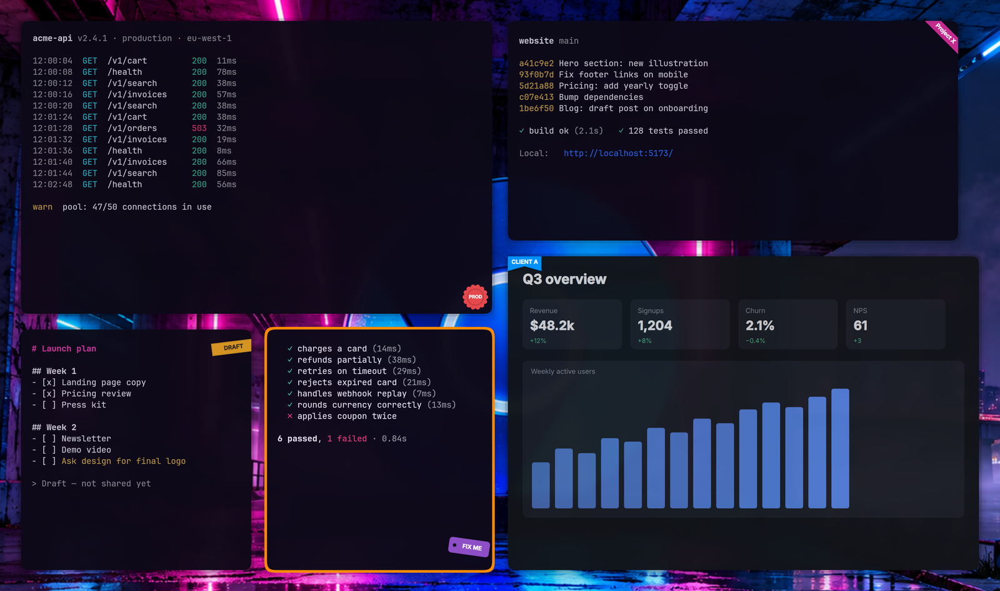
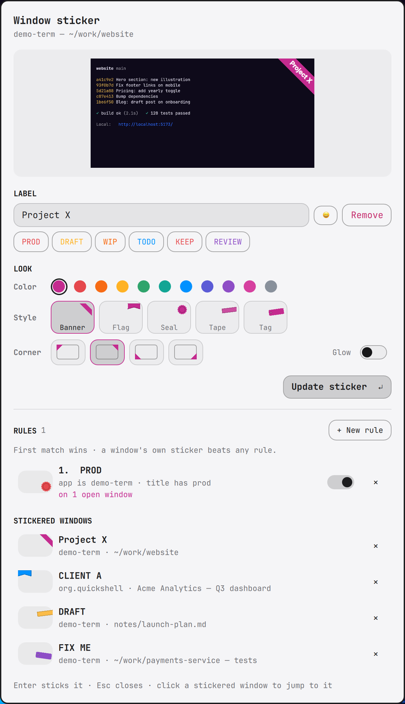
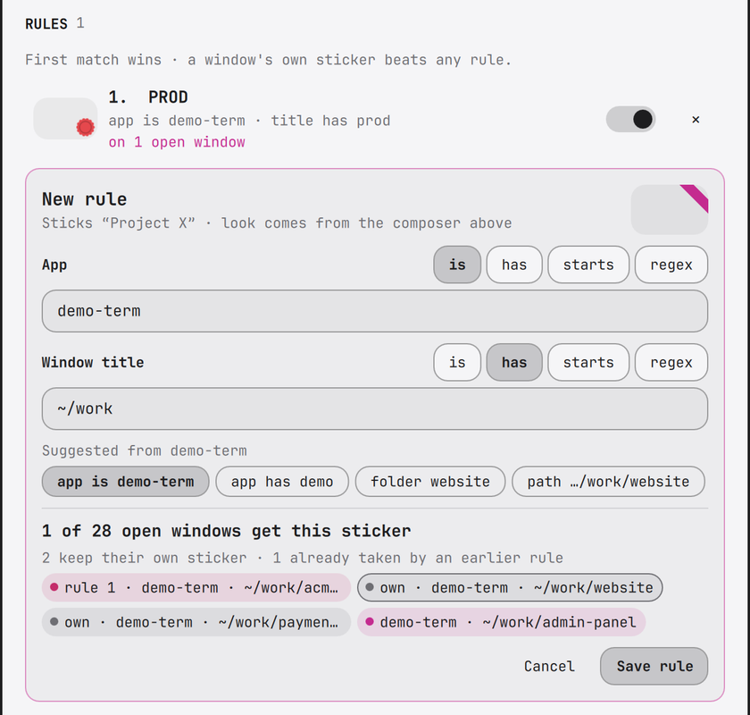

# Window Sticker

Pin a labelled sticker to any window on [Omarchy](https://omarchy.org/):
a diagonal banner, bookmark flag, wax seal, washi tape or luggage tag in
the corner of your choice. Mark windows like "Project X", "PROD" or
"DO NOT CLOSE" and tell them apart at a glance.

Stickers follow their window and stay *under* anything drawn above it:
another fullscreen app, the screensaver, a shown special workspace, or a
floating window on top (partly covered stickers are clipped). They hide
when the window is minimized or on another workspace, and disappear when
it closes.




## Install

Requires Omarchy with the Quickshell-based `omarchy-shell`.

```bash
omarchy plugin add https://github.com/hjanuschka/omarchy-window-sticker --enable
~/.config/omarchy/plugins/io.github.hjanuschka.window-sticker/install.sh
```

The first command clones, validates and enables the plugin. The second
binds **Super+Shift+R** (in `~/.config/hypr/bindings.lua`) and is safe to
re-run. If Super+Shift+R is taken on your setup, change that line in
`bindings.lua` to a free key.

Enabling also offers to place the optional bar widget (🏷️ + sticker
count, click for the overview). To add it later:

```bash
omarchy bar put io.github.hjanuschka.window-sticker --section right
```

## Update

```bash
omarchy plugin update io.github.hjanuschka.window-sticker
```

## Usage

Focus a window and press **Super+Shift+R**. The picker shows a live
preview of that window with the sticker on it.

<p align="center"></p>

| Action | How |
|---|---|
| Add / edit a sticker | type a label (or click a preset), pick color, style, corner, `Enter` |
| Emoji in the label | 😀 button next to the label field |
| Remove a sticker | **Remove** next to the label, or **×** in *Stickered windows* |
| Jump to a stickered window | click it under *Stickered windows* |
| Close | `Esc` |

Presets: `PROD`, `DRAFT`, `WIP`, `TODO`, `KEEP` (DO NOT CLOSE), `REVIEW`.

## Rules

Rules sticker windows automatically, e.g. every kitty whose title has
`prod`. In the picker under **Rules**, click **+ New rule** (or a rule
row to edit it):

<p align="center"></p>

- **App** and **Window title** conditions, each `is` / `has` / `starts` /
  `regex`. Regex errors are shown inline.
- **Suggestions** derived from the focused window: app name, the folder
  or repo in the title, the site, title segments.
- **Live matches**: which open windows the rule would sticker, which keep
  their own sticker, and which an earlier rule already claims. Very broad
  rules get a warning.
- The look (label, color, style, corner, glow) comes from the composer.

The list shows what each rule currently does ("on 3 open windows",
"never applies — rule 1 wins"), with priority arrows (first match wins),
a pause toggle, and delete. A window's own sticker always beats rules.

## Data

Everything lives in `~/.local/state/omarchy-window-sticker/`:

- `stickers.json`: per-window stickers, keyed by window address. They
  survive shell restarts but not a new Hyprland session (windows get new
  addresses). Use rules for anything that should come back.
- `rules.json`: your rules.

Remove all per-window stickers:

```bash
omarchy-shell shell call io.github.hjanuschka.window-sticker clearAll '{}'
```

## Uninstall

```bash
~/.config/omarchy/plugins/io.github.hjanuschka.window-sticker/uninstall.sh
omarchy plugin remove io.github.hjanuschka.window-sticker
rm -r ~/.local/state/omarchy-window-sticker   # optional: drop stickers and rules
```

`uninstall.sh` removes the keybinding (keeping a backup of
`bindings.lua`) and disables the plugin.

## How it works

- Omarchy shell plugin (`keepLoaded` overlay plus an optional bar
  widget). The picker reads the focused window with
  `hyprctl activewindow` before it takes keyboard focus.
- Each sticker is a small layer surface (`omarchy-window-sticker`
  namespace) pinned to a corner of its window; only the sticker area is
  ever covered.
- A 120 ms sync loop, woken early by Hyprland events, re-reads
  `hyprctl clients` / `monitors`, moves stickers, and masks out whatever
  windows stacked above the sticker's window cover (`Stacking.js`). It only runs
  while stickers or rules exist, or the picker is open.
- The preview uses Quickshell's `ScreencopyView` on the target window.

## Development

```bash
git clone https://github.com/hjanuschka/omarchy-window-sticker
cd omarchy-window-sticker && ./install.sh   # symlinks the checkout into the plugins dir
omarchy restart shell                       # after QML edits
```

## License

MIT
